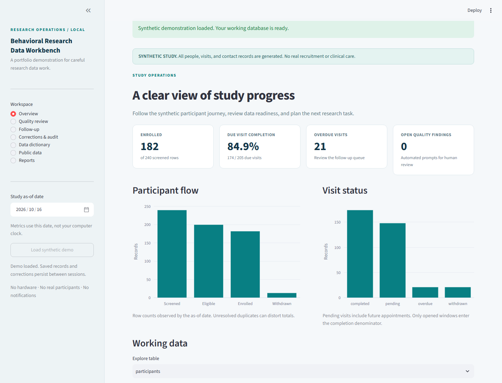

# Behavioral Research Data Workbench

A local research-operations application for screening records, longitudinal data quality,
visit follow-up, traceable corrections, and reproducible reporting. An independent CDC
NHANES case demonstrates actual public questionnaire/laboratory data handling.

**Portfolio demonstration.** All operational participants and contact logs are synthetic.
The public-data case is cross-sectional and unweighted. No participants are recruited,
no messages are sent, and no treatment or diagnostic claims are made.



The [final portfolio and job-application report](reports/FINAL_PROJECT_REPORT.md)
contains measured acceptance results, bilingual resume wording, an interview explanation,
and a five-minute demonstration route. A [standalone HTML version](reports/FINAL_PROJECT_REPORT.html)
is available for reading or browser printing.

## Run locally

Python 3.12 and [uv](https://docs.astral.sh/uv/) are recommended. No GPU, hardware, API key,
Docker, or separate database service is required.

```powershell
uv sync --frozen
uv run research-workbench demo
uv run streamlit run app.py --server.address 127.0.0.1 --browser.gatherUsageStats false
```

Open **http://localhost:8501**. On Windows, `scripts/setup.ps1` prepares the environment and
demo; `start_workbench.cmd` starts the application. Starting the app on an empty database
shows an explicit **Load synthetic demo** action. An existing database and its corrections
are preserved. Close the terminal or press Ctrl+C to stop the app.

Without uv: `python -m venv .venv`, then use `.venv\Scripts\python.exe -m pip install -e .`
and the same commands as `python -m study_workbench.cli ...` / `python -m streamlit ...`.
For development install `-e ".[dev]"`; the lockfile is the authoritative tested dependency set.

## What to explore

- **Overview:** screening, enrollment, EMA response, expected measurement completeness.
- **Quality review:** field-specific findings and a separately labelled injected-error benchmark.
- **Follow-up:** observation-date-aware queue; pending, completed, overdue, and withdrawal handling.
- **Corrections & audit:** required reviewer/reason, before/after values, immutable original records.
- **Data dictionary:** 44 variables, units, valid values and missingness conventions.
- **Public data:** saved CDC analysis, sample flow, source checksums and limitations.
- **Reports:** standalone one-page HTML, CSV and ZIP exports.

The default synthetic data has **240 screenings, 182 enrollments, 364 planned visits,
2,409 EMA prompts and 240 contact logs** (seed42, reference date2026-10-16).
Assignment has no designed treatment effect. Outcomes are illustrative only.

## Reproduce the evidence

```powershell
uv sync --frozen --extra dev
uv run research-workbench demo
uv run research-workbench evaluate
uv run research-workbench report
uv run research-workbench export
uv run research-workbench nhanes
uv run pytest -q --junitxml=artifacts/junit.xml
uv run ruff check .
```

`demo` stores clean records in SQLite and writes separate `data/demo/clean`, `dirty`, and
`truth.csv` fixtures. Reimporting identical source records is idempotent and does not undo
corrections; conflicting raw records are refused. For a different seed use another `--db`.

`evaluate` matches deduplicated `(rule_id, table, row_id, field)` tuples. The default closed
benchmark has **42 labelled findings across23 rule IDs: TP42, FP0, FN0**; clean data produces
zero flags. This is a finite synthetic benchmark, not an estimate of clinical performance.

`nhanes` is the only step that downloads public research data. It validates XPT files,
maintains a SHA256 cache manifest and retains source retrieval dates across offline reruns.
Actual paired adult sample: **8,324**, drawn from9,693 adult demographic records. The report
does not estimate national prevalence or infer causation. See [methods](docs/NHANES_METHODS.md).

For real-browser acceptance (optional development step):

```powershell
uv run playwright install chromium
uv run python scripts/browser_smoke.py
```

This launches a disposable loopback-only server/database and checks pages, correction
persistence and downloads. Screenshots/logs are in ignored `artifacts/browser/`.

## Architecture and safeguards

```text
Synthetic generator → portable CSV contract → SQLite original/working records
                                  ↓                  ↓
                            Quality rules       Reasoned audit
                                  ↓                  ↓
                         Date-aware follow-up → Streamlit + report/exports

Official CDC XPT → validated cache → adult one-to-one join → independent sample report
```

Runtime quality checks never read defect labels. Original imports and audit rows are
append-only through SQLite triggers; corrections are transactional. This protects against
accidental application changes, not a hostile machine administrator. Local single-user
operation has no multiuser authentication, encryption-at-rest configuration or institutional
compliance assessment; do not load real confidential research records into this demo.

Downloaded individual-level public records, operational databases, credentials and virtual
environments are excluded from Git. Aggregate reports and synthetic benchmark evidence
are tracked. The app never downloads automatically or sends communications.

## Documentation

- [Demonstration protocol and operating procedure](docs/PROTOCOL.md)
- [Data dictionary](docs/data_dictionary.csv)
- [Quality rules and benchmark interpretation](docs/QUALITY_RULES.md)
- [NHANES source and analysis methods](docs/NHANES_METHODS.md)
- [One-page synthetic study report](reports/study_report.html)
- [Actual public-data report](reports/nhanes/report.html)
- [Implementation contract](docs/CONTRACT.md)

This project supports evidence of research data management, reproducible analysis and
reporting. It does not establish actual recruitment experience, IRB approval, trial
conduct, clinical validation, or a year of research employment.
