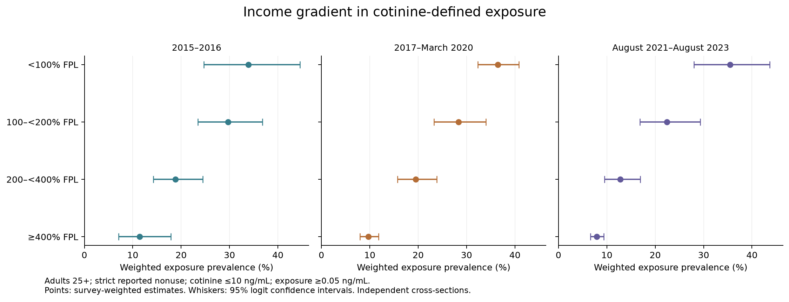
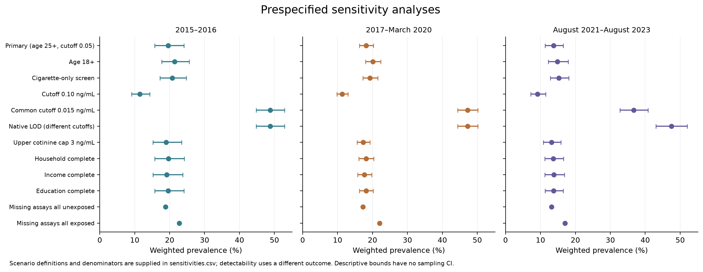
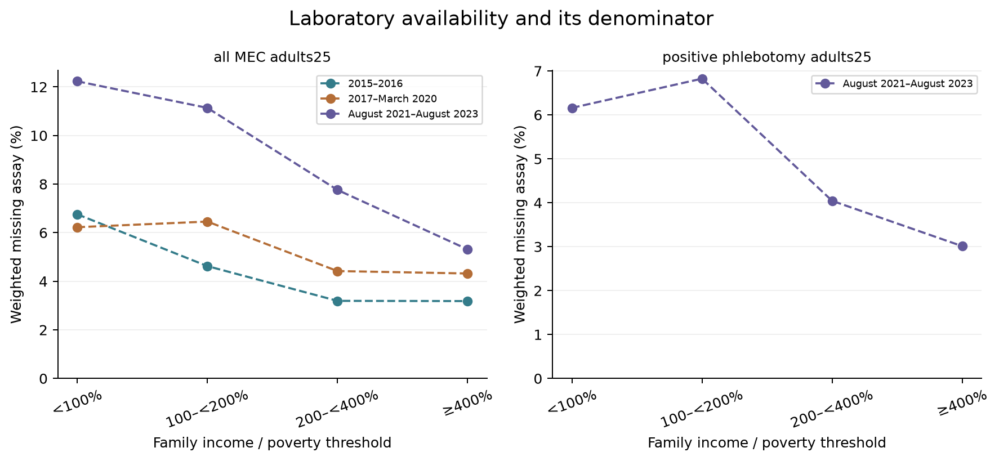

# Tobacco Exposure Equity Study

Independent real-data research · NHANES 2015–2023 · Analysis date 2026-10-16

## 中文研究摘要

这是一项真实公开数据的独立二次研究：从 CDC 收集 17 个原始数据文件，保留 37,464 条人口学记录用于完整抽样设计，再按预先确定的规则形成 11,850 条主要分析记录。研究问题是收入、家庭室内吸烟与可替宁暴露指标的关系，并检查测量方式、检测限和缺失数据对比较的影响。所有研究观察均来自 CDC；没有合成参与者进入结果。

## Research question and contribution

This independent secondary study examines socioeconomic differences in recent nicotine exposure using three non-overlapping NHANES periods. The analysis plan was committed before comparative outcomes were calculated. The work combines biological measurement, behavioral questionnaires, survey inference and a documented measurement/selection audit. It is a replication and extension, not a claim that socioeconomic gradients are a newly discovered phenomenon.

## Primary results

| Period | Analytic n | Exposed n | Weighted exposure | 95% CI (%) | Design df |
| --- | --- | --- | --- | --- | --- |
| 2015–2016 | 3239 | 727 | 19.6% | 15.7 to 24.1 | 15 |
| 2017–March 2020 | 5122 | 1191 | 18.1% | 16.2 to 20.2 | 25 |
| August 2021–August 2023 | 3489 | 474 | 13.7% | 11.3 to 16.6 | 15 |

2015–2016: 19.6% (95% CI 15.7 to 24.1%), based on 3,239 eligible observed assays and 727 exposed observations.

2017–March 2020: 18.1% (95% CI 16.2 to 20.2%), based on 5,122 eligible observed assays and 1,191 exposed observations.

August 2021–August 2023: 13.7% (95% CI 11.3 to 16.6%), based on 3,489 eligible observed assays and 474 exposed observations.

## Prespecified contrasts

All values below are percentage points; confidence intervals include sampling uncertainty, not every source of bias.

| period | contrast | estimate | se | ci_low | ci_high | df |
| --- | --- | --- | --- | --- | --- | --- |
| I | poverty_lt1_minus_ge4 | 22.50 | 6.24 | 9.19 | 35.81 | 15.0 |
| P | poverty_lt1_minus_ge4 | 26.75 | 2.11 | 22.40 | 31.10 | 25.0 |
| L | poverty_lt1_minus_ge4 | 27.57 | 3.70 | 19.69 | 35.45 | 15.0 |
| I_to_P | change_in_poverty_gap_later_minus_earlier | 4.25 | 6.59 | -9.57 | 18.07 | 18.483564956915 |
| P_to_L | change_in_poverty_gap_later_minus_earlier | 0.82 | 4.26 | -7.95 | 9.59 | 24.7986229305137 |
| I_to_L | change_in_poverty_gap_later_minus_earlier | 5.07 | 7.26 | -9.90 | 20.03 | 24.3698333042049 |

I, poverty_lt1_minus_ge4: 22.50 percentage points (95% CI 9.2 to 35.8); the interval excludes zero.

P, poverty_lt1_minus_ge4: 26.75 percentage points (95% CI 22.4 to 31.1); the interval excludes zero.

L, poverty_lt1_minus_ge4: 27.57 percentage points (95% CI 19.7 to 35.5); the interval excludes zero.

I_to_P, change_in_poverty_gap_later_minus_earlier: 4.25 percentage points (95% CI -9.6 to 18.1); the interval includes zero.

P_to_L, change_in_poverty_gap_later_minus_earlier: 0.82 percentage points (95% CI -8.0 to 9.6); the interval includes zero.

I_to_L, change_in_poverty_gap_later_minus_earlier: 5.07 percentage points (95% CI -9.9 to 20.0); the interval includes zero.

## Substantive findings and sensitivity audit

Income differences persist in every primary period, but all prespecified crossperiod changes in the gap have confidence intervals including zero. Point estimates alone do not establish that inequality widened. This distinction is the primary interpretive conclusion.

Measurement audit: in L, native detectability is 47.5%, while the harmonized 0.015 ng/mL cutoff gives 36.7% on exactly the same participants. The 10.8-percentage-point difference is due to the threshold definition. Comparing native detectability across periods would conceal a change visible under a common threshold; neither detectability outcome is the primary 0.05 endpoint.

Population-definition audit: with age18+ rather than25+, the income-gap point estimates are 23.6 percentage points in I and 21.5 in L. Thus the visual direction of the period comparison depends on the target age population. This is a comparison of estimands, not evidence for selecting the age cutoff with a preferred story.

I, matched-sample income OR: 4.63 before household adjustment and 4.81 afterward (n=2,909). Household adjustment does not remove the income association. Odds-ratio changes cannot quantify a proportion mediated, including because odds ratios are non-collapsible.

P, matched-sample income OR: 5.50 before household adjustment and 5.22 afterward (n=4,475). Household adjustment does not remove the income association. Odds-ratio changes cannot quantify a proportion mediated, including because odds ratios are non-collapsible.

L, matched-sample income OR: 6.66 before household adjustment and 6.06 afterward (n=3,059). Household adjustment does not remove the income association. Odds-ratio changes cannot quantify a proportion mediated, including because odds ratios are non-collapsible.

Missingness extremes describe the overall marker prevalence when every unresolved assay is assigned unexposed or exposed and eligible. They are not identified estimates, confidence intervals, or worst-case bounds on the between-income difference; group-specific missingness could move that difference in other ways.

| Scenario | I | L | P |
| --- | --- | --- | --- |
| Primary (age 25+, cutoff 0.05) | 19.6% | 13.7% | 18.1% |
| Age 18+ | 21.4% | 14.9% | 20.1% |
| Common cutoff 0.015 ng/mL | 48.8% | 36.7% | 47.3% |
| Native LOD (different cutoffs) | 48.8% | 47.5% | 47.3% |
| Missing assays all unexposed | 18.8% | 13.2% | 17.3% |
| Missing assays all exposed | 22.7% | 17.1% | 22.1% |

## Adjusted associations

| Period | Model | Association | OR | 95% CI | n | Quality flag |
| --- | --- | --- | --- | --- | --- | --- |
| I | M1_common | Poverty <1 vs ≥4 | 4.63 | 2.00 to 10.71 | 2909 | None |
| I | M2 | Poverty <1 vs ≥4 | 4.81 | 2.07 to 11.17 | 2909 | None |
| I | M2 | Indoor smoking yes vs no | 28.89 | 11.39 to 73.26 | 2909 | None |
| P | M1_common | Poverty <1 vs ≥4 | 5.50 | 4.12 to 7.36 | 4475 | None |
| P | M2 | Poverty <1 vs ≥4 | 5.22 | 3.83 to 7.11 | 4475 | None |
| P | M2 | Indoor smoking yes vs no | 19.94 | 11.61 to 34.25 | 4475 | None |
| L | M1_common | Poverty <1 vs ≥4 | 6.66 | 4.42 to 10.04 | 3059 | None |
| L | M2 | Poverty <1 vs ≥4 | 6.06 | 4.18 to 8.77 | 3059 | None |
| L | M2 | Indoor smoking yes vs no | 19.23 | 8.30 to 44.56 | 3059 | None |

Odds ratios are not prevalence ratios or causal effects. All other model terms are retained in research/models.csv.

## Methods

Population: adults aged 25+ reporting no current cigarettes and explicit five-day nonuse of smoking, smokeless and nicotine-replacement products; the latest period additionally requires the separate e-cigarette item. Unknown responses are retained in audit and excluded from the strict cohort. Current status is not proof of 30-day abstinence; this differs from the exact CDC Data Brief 396 cohort.

Biomarker: observed serum cotinine ≤10 ng/mL defines the marker-restricted cohort; exposure is ≥0.05 ng/mL. Native LODs are 0.015 ng/mL in I/P and 0.010 in L. Published below-LOD values and flags are preserved; missing assays are never replaced by zero. The marker is compatible with secondhand exposure but does not establish its source.

Design: separate period-specific R survey designs use masked strata/PSUs and I WTMEC2YR, P WTMECPRP, L WTPH2YR weights. Full positive-weight samples precede analytic-domain subsetting. L's missing weight column is recovered through a one-to-one HEPA_L link and independently verified against HEPB_S_L; no hepatitis outcomes are analyzed.

Inference: survey-weighted prevalence, logit 95% intervals and design degrees of freedom; poor-minus-affluent prevalence differences use their joint survey covariance. Crossperiod gap contrasts are secondary and assume independent samples. Models use quasibinomial survey logistic regression with robust covariance; odds ratios are association measures, not risk ratios.

Models: M1_all adjusts poverty for age (per decade), recorded sex and race/Hispanic-origin group. M1_common repeats M1 on M2's household-complete sample; M2 adds indoor household smoking. Only M1_common versus M2 supports discussion of coefficient changes, with no causal-mediation interpretation.

Sensitivity: all planned scenarios, income/education/household completeness, assay availability, bounds, native detectability and alternate thresholds are exported. Intervals are pointwise; no familywise multiplicity control is claimed. Exploratory quality flags are not a full certification against NCHS presentation standards. No p-value-based model or threshold selection was performed.

## Figures

Income gradient with survey-based 95% confidence intervals; FPL = federal poverty level.

Sensitivity audit. Different cutoffs and selection rules change the estimand; these are not competing estimates of an identical quantity.

Missing assay proportions have explicitly different denominators. MEC nonresponse and residual phlebotomy-weight-positive missingness must not be conflated.

## Sample flow

The stages are sequential unweighted exclusions. Overall prevalence uses the cotinine-at-most10 stage; later covariate stages are not its denominator.

| period | period_label | stage | n | excluded_from_previous | note |
| --- | --- | --- | --- | --- | --- |
| I | 2015-2016 | all_demographic_records | 9971 | 0 | Full export; no domain filtering |
| I | 2015-2016 | positive_analysis_weight | 9544 | 427 | Blood weight in L; MEC in I/P |
| I | 2015-2016 | age25plus | 5053 | 4491 | Primary adult age restriction |
| I | 2015-2016 | noncurrent_cigarette | 4091 | 962 | Unknown not treated as noncurrent |
| I | 2015-2016 | no_recent_all_products | 3446 | 645 | Explicit five-day nonuse |
| I | 2015-2016 | cotinine_observed | 3290 | 156 | No missing assay substitution |
| I | 2015-2016 | cotinine_at_most10 | 3239 | 51 | Prespecified biomarker cohort cap |
| I | 2015-2016 | income_observed | 2909 | 330 | Poverty contrasts available |
| I | 2015-2016 | education_observed | 2909 | 0 | Descriptive complete cases |
| I | 2015-2016 | indoor_smoking_observed | 2909 | 0 | Full covariate cases |
| P | 2017-March 2020 | all_demographic_records | 15560 | 0 | Full export; no domain filtering |
| P | 2017-March 2020 | positive_analysis_weight | 14300 | 1260 | Blood weight in L; MEC in I/P |
| P | 2017-March 2020 | age25plus | 7912 | 6388 | Primary adult age restriction |
| P | 2017-March 2020 | noncurrent_cigarette | 6450 | 1462 | Unknown not treated as noncurrent |
| P | 2017-March 2020 | no_recent_all_products | 5584 | 866 | Explicit five-day nonuse |
| P | 2017-March 2020 | cotinine_observed | 5262 | 322 | No missing assay substitution |
| P | 2017-March 2020 | cotinine_at_most10 | 5122 | 140 | Prespecified biomarker cohort cap |
| P | 2017-March 2020 | income_observed | 4476 | 646 | Poverty contrasts available |
| P | 2017-March 2020 | education_observed | 4473 | 3 | Descriptive complete cases |
| P | 2017-March 2020 | indoor_smoking_observed | 4472 | 1 | Full covariate cases |
| L | August 2021-August 2023 | all_demographic_records | 11933 | 0 | Full export; no domain filtering |
| L | August 2021-August 2023 | positive_analysis_weight | 7583 | 4350 | Blood weight in L; MEC in I/P |
| L | August 2021-August 2023 | age25plus | 5518 | 2065 | Primary adult age restriction |
| L | August 2021-August 2023 | noncurrent_cigarette | 4678 | 840 | Unknown not treated as noncurrent |
| L | August 2021-August 2023 | no_recent_all_products | 3711 | 967 | Explicit five-day nonuse |
| L | August 2021-August 2023 | cotinine_observed | 3562 | 149 | No missing assay substitution |
| L | August 2021-August 2023 | cotinine_at_most10 | 3489 | 73 | Prespecified biomarker cohort cap |
| L | August 2021-August 2023 | income_observed | 3060 | 429 | Poverty contrasts available |
| L | August 2021-August 2023 | education_observed | 3060 | 0 | Descriptive complete cases |
| L | August 2021-August 2023 | indoor_smoking_observed | 3059 | 1 | Full covariate cases |

## Research interpretation

The engineering contribution is not the dashboard alone. It is a traceable chain from a prespecified question to source-codebook reconciliation, harmonized eligibility, correct design-based uncertainty, sensitivity checks and an interpretable report.

The L weight discrepancy demonstrates why reading documentation without inspecting file contents is insufficient. The independent weight-file comparison tests a specific repair rather than silently substituting generic examination weights.

The apparent time pattern combines changes in sampling, blood response, laboratory limits and recent-use interviewing (CAPI versus ACASI). It cannot be interpreted as an intervention effect, individual follow-up, or a causal pandemic effect.

Household indoor smoking is one possible exposure context. The association between income and the biomarker can also reflect unmeasured settings, product reporting and selection. Adjustment and a smaller coefficient alone do not prove mediation.

## Limitations

CDC collected the original measurements. This repository independently acquires and analyzes public files; it does not establish recruitment, consent, participant communication, IRB implementation or clinical employment experience.

Repeated cross-sectional observational data do not identify causal effects. Income is top-coded, age is top-coded, nicotine has multiple sources, and short-window questionnaires may misclassify exposure. The cohort definition is explicitly CDC-aligned rather than an exact replication.

Missing laboratory and questionnaire data can leave selection bias after published weighting. Phlebotomy weights already address blood nonresponse; no second correction for the same missing draws is applied. Descriptive missing-outcome bounds are not confidence intervals.

Sparse indoor-smoking subgroups and wide model intervals require caution. All planned estimates, warnings and unstable results are retained in the CSVs. This is a portfolio research study, not a peer-reviewed publication or validated clinical tool.

## Reproducibility and provenance

Run `uv run research-workbench research --offline` after the initial verified acquisition. See research/pipeline_run.json for code, input and output hashes; analysis_metadata.json for runtime, formulas and warnings. Raw/canonical individual records are excluded from Git; aggregate tables and source metadata are retained.

| Source | Period | Records | SHA256 |
| --- | --- | --- | --- |
| DEMO_I | I | 9971 | c9297c6c37ae8f78f29be9568fa2a03cf3b112616a39afee04030fc775a66a0d |
| SMQ_I | I | 7001 | 529ce1c407e99dce937ca75d14c8c630e0c9c30a4a9a851760cd2884bbb28fe0 |
| SMQRTU_I | I | 6744 | b156a290cbeaff07aaf047d064f3c85e9786fe79824588f58508f452130920e5 |
| SMQFAM_I | I | 9971 | 41cc8d1ab2a53af1ee7e7f515e2a010523ca58c3d256c201eec9b59044896461 |
| COT_I | I | 8608 | 272e52c1f3e9ec23d515facce375a62719a6f17f5ce46122f9c54e39a582b665 |
| P_DEMO | P | 15560 | 2e46c6c26bf77cd8989f64011ace12cbf42c0f3e03414eb59acc5328c8f87913 |
| P_SMQ | P | 11137 | 29b7f6c59ab570c042c866312f0eb4329009e85fadbda6f9427a8bf31ecb3a3f |
| P_SMQRTU | P | 10409 | 142c4c7587fdefab420707cca4c412bf0cb3536d0daf1282f56cb4a4bf100c4d |
| P_SMQFAM | P | 15560 | f305ba974aac5df79eb9bea139161ac45f338db2b5af5f5f79b400446088b0c7 |
| P_COT | P | 13027 | 2c98920928af839775220dc9eefb553a4d01309a54addd3992a9875313e2961f |
| DEMO_L | L | 11933 | ca4374a158b493b8b0163e1388da21d57a18d1b9cecff2aa4e2fa2bec494fe23 |
| SMQ_L | L | 9015 | abbefebfa5585b1e19c079fa14be20c113a4649318070197214b258d05b93c50 |
| SMQRTU_L | L | 7199 | 9788fb55f27a565d3852b0835395c724b07731ebaea11e1284145ddc8690bcec |
| SMQFAM_L | L | 11933 | 1f5c0c3c3fe674ec8ffb809131b970db4f3194f8975d16aca466e59f42216d9c |
| COT_L | L | 8493 | 79a68f2eb693382e51fc3e95fac4a51b399ce3f589aa7fd14f8df91729be6d38 |
| HEPA_L | L | 8611 | 0eacb9b1b0bce97ac85aa5df1f95f78aca36bff72c9f07ba70a9d381579b5517 |
| HEPB_S_L | L | 8611 | 1b55c7cb6f0c9ce5991cade1c79271b36982075a74c15721c3eacf494747d7d7 |

## Complete results

All subgroup estimates, complete model coefficients, scenario definitions and missingness denominators are in reports/research/*.csv. The saved app reads these exact files.

## References

- [Brody, Faust & Tsai. NCHS Data Brief 396 (2021): prior socioeconomic gradients and cotinine definition.](https://www.cdc.gov/nchs/products/databriefs/db396.htm)

- [Tsai et al. MMWR 2018: historical secondhand-smoke exposure research.](https://www.cdc.gov/mmwr/volumes/67/wr/mm6748a3.htm)

- [CDC NHANES: sample weighting guidance.](https://wwwn.cdc.gov/nchs/nhanes/tutorials/weighting.aspx)

- [CDC NHANES: variance estimation and domain analysis.](https://wwwn.cdc.gov/nchs/nhanes/tutorials/varianceestimation.aspx)

- [CDC COT_L: August 2026 release, phlebotomy weights, detection limits and missingness.](https://wwwn.cdc.gov/Nchs/Data/Nhanes/Public/2021/DataFiles/COT_L.htm)

- [R survey: design-based generalized linear models.](https://r-survey.r-forge.r-project.org/pkgdown/docs/reference/svyglm.html)
